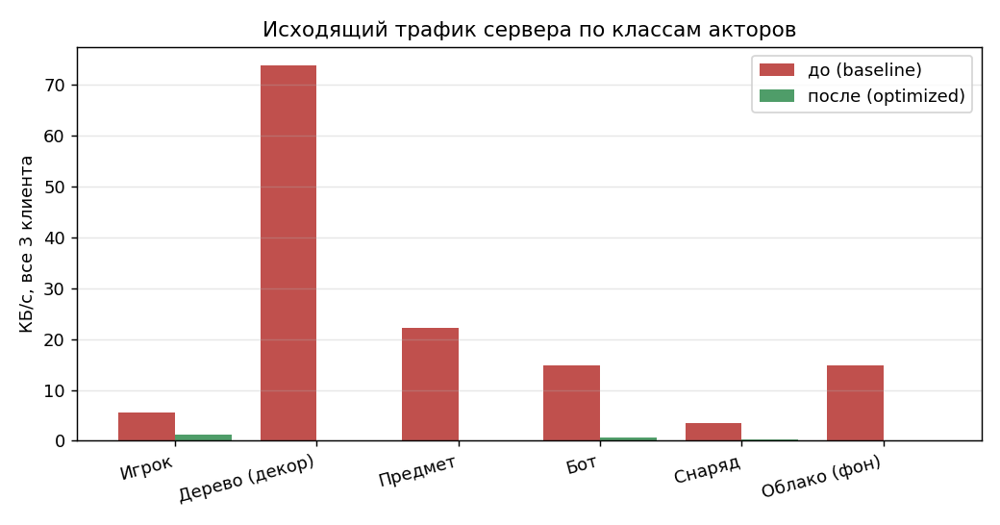
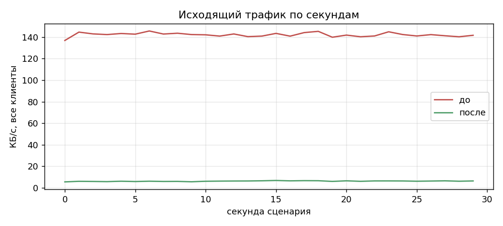

# ПР №5 · Базовый профиль репликации («до»)

> Файл строится автоматически: `python tools/repl_report.py` из `docs/repl/baseline.json`. Условие — `Практическая_работа__5.pdf`
> (в нём Unreal Engine; по договорённости с преподавателем работа выполнена в **Godot** на собственном UDP-протоколе ПР №1–3).

## 1. Что измеряем

**Нагруженная сцена** («длинный уровень» платформера, 16000 px, сервер-авторитетный мир `ReplWorld`), на старте **68 реплицируемых акторов**
(не менее 50 по заданию) + по одному аватару на клиента + снаряды, которые появляются и исчезают:

| Класс | Сколько | Поведение |
| :--- | ---: | :--- |
| Деревья (декор) | 40 | стоят на месте; изредка снаряд попадает и меняет hp |
| Предметы | 12 | лежат; при подборе игроком флаг `st` меняется, через 15 с возвращается |
| Боты | 8 | патрулируют ±150 px, стреляют по игроку в радиусе 700 px |
| Облака (фон) | 8 | плывут по небу 5–8 px/с |
| Снаряды | 0…~15 | летят 1,5 с, исчезают; попадают в деревья/ботов |
| Игроки | 3 | аватары клиентов: идут, стреляют; видны всем |

**Baseline = всё как в наивной реализации**: каждый клиент получает **все** акторы мира; на каждом сетевом тике (30 Гц) шлётся
**полное состояние** каждого актора (21 байт: `id u16, cls u8, x y vx vy float32, st u8, hp u8`); без дельт, без квантования,
без сна статики, без приоритетов. Репликация включена всем всем без ограничений — как требует пункт 1 задания.

**Сценарий идентичен «до» и «после»**: seed мира 7, 3 клиента (UDP-логика `NetNode` на виртуальном времени), 2 с входа
(начальная синхронизация, фаза `join`) и 30 с игры (фаза `steady`): клиент 0 идёт вправо, клиент 1 влево вдвое медленнее,
клиент 2 стоит 10 с, стреляя, затем идёт влево. За прогон: 114 выстрелов, 102 попаданий
в деревья, 11 в ботов, 10 подборов предметов. Мир от репликации не зависит, поэтому
контрольная сумма состояния мира в конце прогона у «до» и «после» совпадает (`3456157062`).

## 2. Чем измеряем (аналог `netprofile enable` + Network Profiler)

| Unreal Engine | Эта работа |
|---|---|
| `netprofile enable` / Network Profiler | `ReplProfiler` (`godot/scripts/repl/repl_profiler.gd`): включён всегда, считает на сервере |
| исходящий трафик сервера | байты «на проводе» = полезная нагрузка + заголовок протокола 8 Б + IPv4/UDP 28 Б — как считает `NetNode` |
| частота обновлений | записей (обновлений актора) и пакетов в секунду на клиента |
| «тяжёлые» акторы | таблица актор → байты за прогон (раздел 5) |
| сверка с сетью | суммарные байты канала `LoopLink.sent_bytes` и счётчики `NetNode.Peer.bytes_out_total` |

Профиль сохраняется в `docs/repl/baseline.json` (полный) и `docs/repl/results.json` (все 15 конфигураций).

## 3. Результат: исходящий трафик сервера

| Показатель (фаза steady, 30 с) | Значение |
| :--- | ---: |
| Исходящий трафик, всего (3 клиента) | **142.3 КБ/с** |
| Исходящий трафик на одного клиента | **47.4 КБ/с** |
| Пик за 100 мс (все клиенты) | 149.2 КБ/с |
| Пакетов в секунду на клиента | 66.3 |
| Обновлений акторов в секунду на клиента | 2 189 |
| Средний размер записи | 21.1 Б |
| Доля заголовков (8 Б + 28 Б IP/UDP на пакет) | 4.9% |
| Акторов, известных клиенту (среднее / максимум) | 72.9 / 76 из 72 |
| Начальная синхронизация: надёжных байт на 3 клиентов | 5 244 Б (219 записей) |





## 4. Куда уходит трафик по классам

| Класс | Акторов | Обн./с на клиента | КБ/с (все клиенты) | Доля |
| :--- | ---: | ---: | ---: | ---: |
| Игрок | 3 | 90.0 | 5.54 | 4% |
| Дерево (декор) | 40 | 1 200.0 | 73.83 | 52% |
| Предмет | 12 | 360.0 | 22.15 | 16% |
| Бот | 8 | 240.0 | 14.77 | 10% |
| Снаряд | динамически | 59.4 | 3.50 | 2% |
| Облако (фон) | 8 | 240.0 | 14.77 | 10% |

Главный вывод baseline: **деревья, предметы и облака — 78% трафика**, хотя почти ничего не меняют
(одни только деревья — 52%). Самое «горячее» для игры — боты и снаряды — занимает лишь 13%.
При этом каждый клиент получает весь уровень 16000 px, а видит из него 1280 px (8%).

## 5. «Тяжёлые» акторы

В baseline все акторы одинаково «тяжёлые» (полное состояние на каждом тике), поэтому топ-10 по байтам — это просто первые по `id`
из самых частых; по-настоящему показательна таблица по классам выше.

| id | Класс | Записей | КБ за прогон | КБ/с |
| :--- | ---: | ---: | ---: | ---: |
| 1 | Игрок | 2 700 | 55.4 | 1.85 |
| 2 | Игрок | 2 700 | 55.4 | 1.85 |
| 3 | Игрок | 2 700 | 55.4 | 1.85 |
| 100 | Дерево (декор) | 2 700 | 55.4 | 1.85 |
| 101 | Дерево (декор) | 2 700 | 55.4 | 1.85 |
| 102 | Дерево (декор) | 2 700 | 55.4 | 1.85 |
| 103 | Дерево (декор) | 2 700 | 55.4 | 1.85 |
| 104 | Дерево (декор) | 2 700 | 55.4 | 1.85 |
| 105 | Дерево (декор) | 2 700 | 55.4 | 1.85 |
| 106 | Дерево (декор) | 2 700 | 55.4 | 1.85 |

## 6. Как воспроизвести

```powershell
# PowerShell 7, из корня репозитория (кириллица: вывод Godot уже переключён скриптом на UTF-8)
.\run_godot_demo.ps1 -Godot "C:\Godot\Godot_v4.7.2-stable_win64_console.exe" -Role ReplProfile
```
или вручную: `godot --headless --path godot --script tests/run_repl_profile.gd -- --out=docs/repl` и `python tools/repl_report.py`.
Живая визуализация — в самой игре: Меню → «Лаборатория репликации» (или `-Role Lab -Repl baseline`); клавиша `O` включает оптимизации «на лету».
