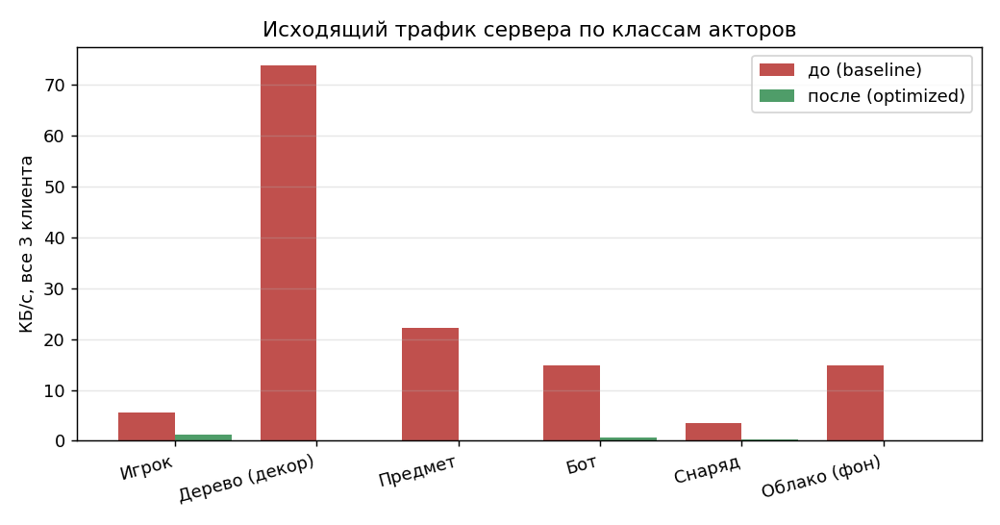
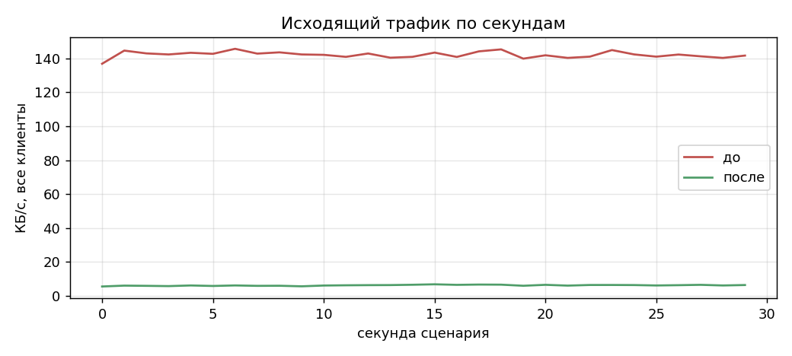
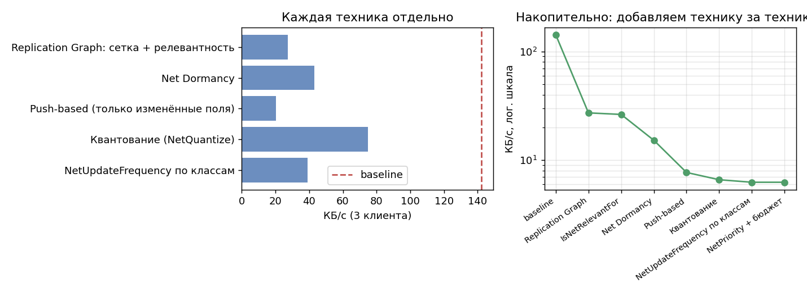
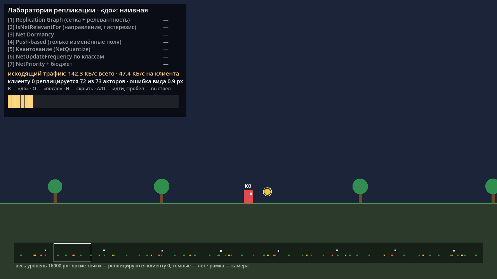
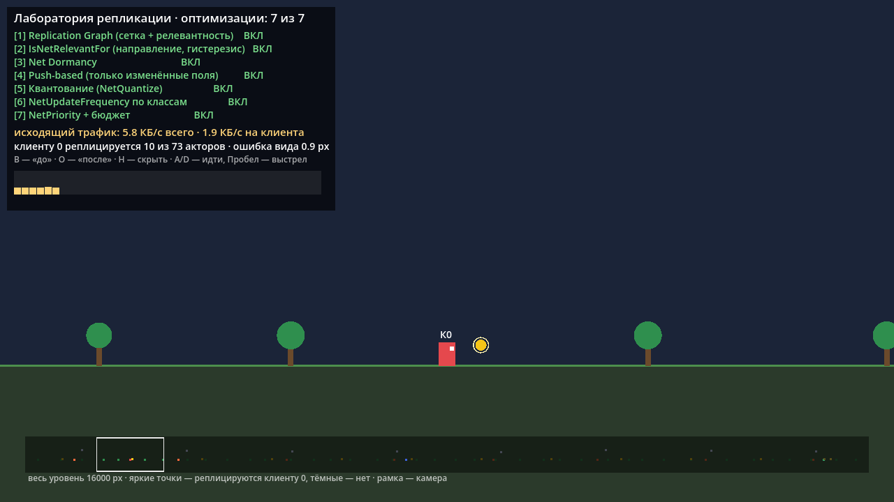
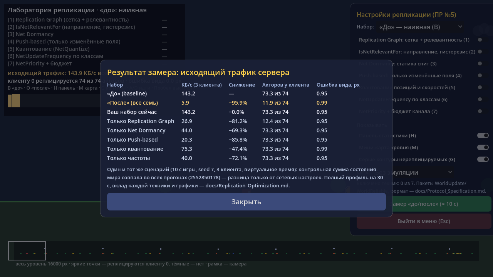
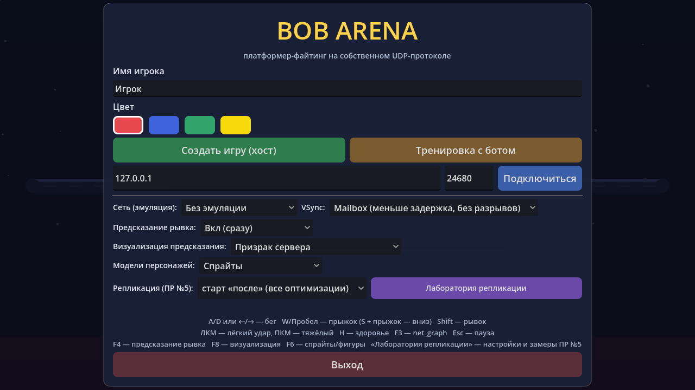

# ПР №5 · Оптимизация репликации: результат («после») и сравнение

> Файл строится автоматически: `python tools/repl_report.py` из `docs/repl/*.json`. Базовый профиль — `docs/Replication_Baseline.md`.
> Условие — Unreal Engine; по договорённости с преподавателем выполнено в **Godot**: механизмы UE (Replication Graph, Net Dormancy,
> Push Model, NetQuantize, NetUpdateFrequency, NetPriority, IsNetRelevantFor) реализованы поверх собственного UDP-протокола ПР №1–3.

## 1. Итог

**Исходящий трафик сервера упал с 142.3 до 6.2 КБ/с — на 95.6%** при том же сценарии (3 клиента, 30 с, seed 7).
Это заметно больше ориентира 40–60% из задания: сцена — длинный уровень, на котором клиент видит около 8% акторов, а ≈ 75% акторов — статика (деревья и предметы),
поэтому для неё выигрыш максимален (см. раздел 6 о границах). Качество картинки при этом не страдает: ни один видимый актор не пропал,
средняя ошибка позиции 1.01 → 1.04 px.

| Показатель (фаза steady) | До | После | Изменение |
| :--- | ---: | ---: | ---: |
| Исходящий трафик, всего (КБ/с) | 142.3 | 6.2 | −95.6% |
| Исходящий трафик на клиента (КБ/с) | 47.4 | 2.1 | −95.6% |
| Пик за 100 мс, все клиенты (КБ/с) | 149.2 | 8.2 | −94.5% |
| Реплицируемых акторов у клиента (среднее) | 72.9 | 12.1 | −83% |
| …из акторов в мире | 72 | 72 | — |
| Обновлений акторов в секунду на клиента | 2 189 | 151 | −93.1% |
| Пакетов в секунду на клиента | 66.3 | 33.8 | −49% |
| Средний размер записи (Б) | 21.1 | 6.1 | −71% |
| Надёжный трафик начальной синхронизации, 3 клиента (Б) | 5 244 | 600 | −89% |

Условия «до» и «после» идентичны: тот же seed, те же клиенты и команды; контрольная сумма мира совпала (`3456157062`),
т. е. разница только от сетевых настроек. Таблицы собраны из `docs/repl/baseline.json` и `docs/repl/optimized.json`.





По классам (КБ/с — все клиенты вместе, обновлений/с — на одного клиента):

| Класс | КБ/с до | КБ/с после | Обн./с до | Обн./с после |
| :--- | ---: | ---: | ---: | ---: |
| Игрок | 5.54 | 1.18 | 90.0 | 80.3 |
| Дерево (декор) | 73.83 | 0.06 | 1 200.0 | 2.0 |
| Предмет | 22.15 | 0.01 | 360.0 | 0.4 |
| Бот | 14.77 | 0.63 | 240.0 | 42.7 |
| Снаряд | 3.50 | 0.33 | 59.4 | 20.8 |
| Облако (фон) | 14.77 | 0.07 | 240.0 | 4.9 |

## 2. Применённые техники (все семь; требовалось минимум две)

Включение каждой — флаг в `ReplCfg`; в игре переключаются в настройках лаборатории (справа) и клавишами `1`–`7`.

1. **Replication Graph — Grid Spatialization** (`ReplGrid`, `ReplServer._update_relevance`). Мир разбит на ячейки по 500 px; движущиеся
   акторы перекладываются между ячейками. На сетевом тике сервер для каждого клиента просматривает только ячейки в радиусе 1520 px вокруг
   аватара и точно проверяет релевантность. Класс-зависимые радиусы (`CULL_PX`, аналог `NetCullDistance`): деревья/облака 1000 px, предметы 1100,
   боты и снаряды 1400 (они опасны и вне экрана), игроки — всегда. Вышедшие из зоны получают надёжный `OP_DESTROY`, вошедшие — `OP_UPSERT`
   с полным состоянием. Камера видит ±640 px, радиусы заметно больше — «выскакивания» нет (в тестах и в профиле пропаж 0).
2. **IsNetRelevantFor** (доп. задание). Направление «взгляда» — куда смотрит аватар (`st` бит 0): за спиной радиус декора и предметов ×0,75 (1000 → 750 px, всё равно больше
   полуокна камеры 640 px, поэтому видимое не пропадает); враги и снаряды опасны с любой стороны — радиус не сужается. Плюс гистерезис 120 px: уже известный актор отпускается дальше, чем берётся, — нет мигания на границе.
3. **Net Dormancy** (`CAN_SLEEP`, `ReplServer._distribute_dirty`). Деревья и предметы — `DORM_Initial`: передаются один раз при появлении
   и больше не обновляются. Если актор изменился (попадание в дерево, подбор предмета) — «пробуждение»: один **надёжный** пакет с полным состоянием
   (`FlushNetDormancy`), потому что у спящих нет периодических ключевых кадров, которые вылечили бы потерю. За прогон: 112 пробуждений.
4. **Push-based** (`ReplActor.set_*`, `ReplCodec` с `FMT_DELTA`). Актор сам помечает изменённое поле «грязным»; сервер не сравнивает состояние
   каждого актора с отправленным, а накапливает маску на клиента и шлёт только изменённые поля (бот в патруле: `id + mask + x` = 5 Б вместо 21 Б).
   Раз в секунду для живых акторов — ключевое полное состояние: лечит потерянные ненадёжные дельты.
5. **Квантование** (`FMT_QUANT`, аналог `FVector_NetQuantize`). Позиция — `u16` с шагом 0,25 px (ошибка ≤ 0,125 px), скорость — `i8` с шагом 8 px/с
   (≤ 4 px/с) вместо `float32`; весь уровень 16000 px помещается в `u16`. Клиент экстраполирует позицию по скорости (dead reckoning), поэтому ошибка
   скорости на 0,3 с даёт ≤ 1,2 px.
6. **NetUpdateFrequency по классам** (`OPT_HZ`). Игровое (игроки, боты, снаряды) — как было, 30 Гц; деревья 2 Гц, облака и предметы 5 Гц.
   Обновления разнесены по сетевым тикам (`id % период`, аналог frequency buckets из Replication Graph), чтобы 40 деревьев не уходили одним
   всплеском (проверено тестом `t_freq`).
7. **NetPriority + бюджет** (доп. задание, `PRIORITY`, `budget_bytes`). При нехватке бюджета на тик актор выбирается по `приоритет × время с последней
   отправки`: важное (игроки 3, снаряды 2,5, боты 2) обгоняет декор (0,3 и 0,2), а редкое не голодает — его очередь растёт. Эффект виден только при
   насыщении канала, см. раздел 5.

Новые пакеты: `T_WORLD_UPDATE` (13, ненадёжный) и `T_WORLD_RELIABLE` (14, надёжный) — формат в `docs/Protocol_Specification.md`, раздел «ПР №5».

## 3. Почему эти техники сработали именно для нашего жанра

Жанр — 2D-платформер с боковой прокруткой и стрельбой: уровень длинный, камера показывает узкое окно вокруг своего персонажа, ≈ 75% объектов —
статичный декор и предметы, а «игровое» (враги, снаряды, игроки) — небольшая доля.

* **Релевантность по X** срабатывает, потому что в боковом скролле интересный клиенту мир — узкая полоса вокруг камеры. Радиус по одной оси и
  сетка из ячеек дают дешёвый запрос; с ростом уровня трафик на клиента почти не растёт (определяется окрестностью, а не размером мира).
  В самой арене ПР №4 (один экран 1280 px) релевантность ничего бы не дала — поэтому сцена-нагрузка сделана «длинным уровнем».
* **Dormancy и push** убирают то, что не меняется: деревья и подбираемые предметы большую часть времени неподвижны. После этих двух техник деревья
  стоят 0.06 КБ/с вместо 73.83.
* **Квантование безопасно** для 2D: 0,25 px много меньше пикселя на экране; игровая физика на сервере остаётся точной, квантуется только то, что видят клиенты.
* **Пониженная частота декора** незаметна, потому что декор почти не движется, а облако экстраполируется по скорости; игровое оставлено на 30 Гц, чтобы
  попадания и перемещения врагов не страдали.
* **Приоритеты** важны в боях: именно в стычках трафик растёт (снаряды), а канал ограничен — декор должен уступать.

## 4. Вклад каждой техники

Каждая техника в одиночку (остальные выключены), КБ/с на 3 клиентов; baseline = 142.3 КБ/с:

| Техника отдельно | КБ/с | Снижение | Ошибка вида, px |
| :--- | ---: | ---: | ---: |
| Replication Graph: сетка + релевантность | 27.2 | −81% | 1.01 |
| Net Dormancy | 43.1 | −70% | 1.01 |
| Push-based (только изменённые поля) | 20.3 | −86% | 1.01 |
| Квантование (NetQuantize) | 74.8 | −47% | 1.04 |
| NetUpdateFrequency по классам | 39.1 | −73% | 1.01 |
| NetPriority + бюджет | 91.3 | −36% | 1.01 |

Накопительно (порядок добавления соответствует списку выше):

| Набор | КБ/с | Снижение от baseline | Акторов у клиента |
| :--- | ---: | ---: | ---: |
| + Replication Graph: сетка + релевантность | 27.2 | −80.9% | 12.6 |
| + IsNetRelevantFor: направление + гистерезис | 26.3 | −81.5% | 12.1 |
| + Net Dormancy | 15.2 | −89.3% | 12.1 |
| + Push-based (только изменённые поля) | 7.7 | −94.6% | 12.1 |
| + Квантование (NetQuantize) | 6.6 | −95.4% | 12.1 |
| + NetUpdateFrequency по классам | 6.2 | −95.6% | 12.1 |
| + NetPriority + бюджет | 6.2 | −95.6% | 12.1 |



Замечания к таблицам: (а) техники перекрываются — «Push отдельно» уже убирает почти весь трафик статики, поэтому Dormancy после Push даёт меньше, чем сам по себе;
(б) «NetPriority отдельно» снижает трафик только потому, что бюджет 1000 Б/тик урезает обновления (спрос baseline — 1491 Б/тик), ценой видимой потери
актуальности — это не оптимизация, а ограничитель, он нужен для приоритета; (в) когда трафик уже мал, последние техники (квантование, частоты) дают единицы процентов, а главной статьёй становятся заголовки пакетов
(57% трафика «после», у baseline 5%).

## 5. NetPriority под нагрузкой (доп. задание)

Чтобы приоритет проявился, канал нужно насытить: релевантность выключена, бюджет 600 Б на клиента на сетевой тик (спрос 1491 Б).
Без приоритета бюджет расходуется по порядку `id` — первыми идут деревья, и до ботов и снарядов очередь не доходит; с приоритетом выбирается самое
«просроченное по приоритету». Трафик одинаков (56.2 против 56.2 КБ/с), меняется то, на что он потрачен:

| Класс | Обн./с без приоритета | Обн./с с приоритетом | Ошибка без, px | Ошибка с, px |
| :--- | ---: | ---: | ---: | ---: |
| Игрок | 90.0 | 90.0 | 3.0 | 3.0 |
| Бот | 0.0 | 240.0 | 78.5 | 1.5 |
| Снаряд | 6.6 | 59.4 | 54.9 | 5.3 |
| Облако (фон) | 0.0 | 40.0 | 112.1 | 0.1 |
| Дерево (декор) | 750.0 | 133.3 | 0.0 | 0.0 |

## 6. Качество, цена и границы выводов

| Показатель качества | До | После |
| :--- | ---: | ---: |
| Видимых акторов выбрано для проверки (10 раз/с) | 6 407 | 6 407 |
| Видимых акторов, которых нет у клиента | 0 | 0 |
| Средняя ошибка позиции видимых, px | 1.01 | 1.04 |
| 95-й процентиль ошибки, px | 5.33 | 5.33 |
| Максимальная ошибка, px | 5.33 | 5.45 |

* **Ошибка ≈ 1.0 px** одинакова до и после: это шаг мира за тик при экстраполяции (снаряд 320 px/с ÷ 60 = 5,3 px, игрок до 4,3 px), а не следствие оптимизаций.
* **Потери и задержка**: тест `t_loss` — задержка 25 мс и 15% потерь в обе стороны, 15 с игры: видимые акторы на месте, hp деревьев и состояние предметов
  у клиента совпадают с серверными, боты в пределах 60 px. Порядок пакетов: опоздавший `UPSERT` не воскрешает удалённый актор («надгробия»), опоздавшее
  обновление старше применённого отбрасывается (тест `t_reorder`).
* **CPU**: время сетевого тика на клиента в GDScript — 861 мкс против 131 мкс (меряется реальными часами, значения ориентировочные): релевантность
  и push заменяют обход всех акторов обходом соседних ячеек и «грязных» акторов.
* **Почему −96%, а не 40–60%.** Ориентир из задания рассчитан на сцены, где большая часть объектов видна. Здесь клиент видит ≈ 8% уровня и ≈ 75% объектов статичны.
  На компактной арене с видимым целиком миром эффект релевантности исчезнет, и останутся Push, Dormancy, квантование и частоты. По таблице раздела 4 каждая из них
  в одиночку даёт −86% (Push), −73% (частоты), −70% (Dormancy), −47% (квантование) — то есть и без релевантности ориентир перекрыт, хотя порядок величин другой.
* **Что не моделировалось**: реальная сеть с джиттером в профиле (профиль идёт на виртуальном времени без потерь — так числа воспроизводимы; потери и задержку
  проверяют тесты), байты считаются «на проводе» (+28 Б IPv4/UDP), без шифрования; сжатие `u16`-идентификаторов в 1 байт на клиента и объединение мелких
  пакетов — следующие шаги.

### Как это увидеть в игре

Всё доступно из самой игры: **Меню → «Лаборатория репликации»** (строка «Репликация (ПР №5)» под настройками предсказания). Справа — настройки: набор «до»/«после»/свой, семь переключателей техник, оверлеи, профиль сети из настроек игры, кнопка «Замер». Слева — счётчики сервера в реальном времени, внизу — мини-карта уровня (яркие точки реплицируются клиенту 0).

| «до» | «после» |
|---|---|
|  |  |

Кнопка «Замер «до/после»» прогоняет тот же сценарий на 10 с (около 10–15 с ожидания) и показывает таблицу: «до», «после», ваш текущий набор и пять техник по отдельности:



Меню с новой строкой: 

## 7. Как воспроизвести

```powershell
# PowerShell 7, из корня репозитория
.\run_godot_demo.ps1 -Godot "C:\Godot\Godot_v4.7.2-stable_win64_console.exe" -Role ReplProfile   # профиль + эти отчёты
.\run_godot_demo.ps1 -Godot "C:\Godot\Godot_v4.7.2-stable_win64_console.exe" -Role Lab            # игра сразу на экране лаборатории (или Меню → «Лаборатория репликации»)
.\run_godot_demo.ps1 -Godot "C:\Godot\Godot_v4.7.2-stable_win64_console.exe" -Role Tests          # все автотесты, в т.ч. репликации
```
