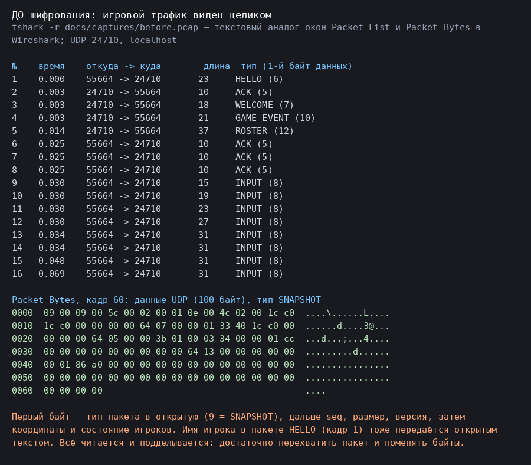
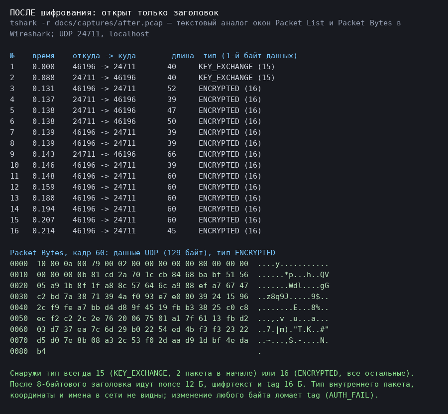

# Security: шифрование UDP-протокола (ПР №6)

Ветка: `feature/encryption`. Игра — Godot 4 (с преподавателем согласовано делать в Godot, а не в Unreal Engine); C++-часть проекта
(ПР №1–3) получила тот же протокол на OpenSSL 3, чтобы доказать совместимость двух независимых реализаций.

**Что сделано:** обмен ключами X25519 → HKDF-SHA256 → AES-256-GCM поверх UDP-протокола игры. Заголовок пакета остаётся открытым и
входит в AAD, поэтому ACK, повторная передача и дедупликация (ПР №3) работают без изменений. Шифрование встроено в `NetNode`
(игра ПР №4/5 запускается с флагом `--encrypt=1` или переключателем в меню) и в C++ `secure_server_app` / `secure_client_app`.

Содержание: [1. Модель угроз](#1-модель-угроз) · [2. Wireshark до/после](#2-скриншоты-wireshark) · [3. Обмен ключами](#3-схема-обмена-ключами) ·
[4. Алгоритмы](#4-выбранные-алгоритмы-и-обоснование) · [5. Формат пакета](#5-формат-зашифрованного-пакета) · [6. Тесты](#6-тесты) ·
[7. Ограничения](#7-известные-ограничения) · [8. Отличия от каркаса задания](#8-отличия-от-каркаса-из-материалов-задания) ·
[9. Ответы на вопросы](#9-ответы-на-вопросы-к-работе) · [10. Что проверялось, а что нет](#10-что-проверялось-а-что-нет)

## 1. Модель угроз

- **Пассивный сниффер** (Wi-Fi в кафе, провайдер, сосед по сети, администратор VM): читает все датаграммы. До шифрования он видит имена игроков,
  координаты, выстрелы, состояние матча (docs/img/capture_before.png). Цель — сделать содержимое нечитаемым.
- **Активный атакующий на пути (MITM «на проводе»)**: может менять байты, удалять, дублировать и проигрывать заново перехваченные пакеты,
  подставлять свои. Цель — любое изменение/повтор обнаруживается и пакет отбрасывается, а сессию нельзя «сломать» мусором.
- **Подделка источника**: рассылка `KEY_EXCHANGE` с чужих адресов — сервер не должен тратить на это неограниченно CPU и не должен терять существующие сессии.
- **Вне модели** (см. раздел 7): атакующий, который активно подменяет сам обмен ключами (голый DH не аутентифицирует сервер); DDoS по каналу
  (его закрывает не криптография, а прокси — docs/Cloudflare_Spectrum_Setup.md); компрометация конечной машины.
- **Что защищаем:** команды движения и ввода (`INPUT`, `MOVEMENT`), выстрелы (`SHOOT`), снимки мира, события матча, имена игроков (`HELLO`/`ROSTER`).
  Логина и пароля в протоколе игры нет; если их добавят, они поедут внутри `ENCRYPTED` так же.

## 2. Скриншоты Wireshark

Захват сделан **настоящим сниффером ядра** (`tcpdump -i lo`) на реальном UDP между двумя процессами Godot (сценарий T1 из ПР №4:
хост + клиент, которым управляет скрипт), файлы можно открыть в Wireshark: `docs/captures/before.pcap` (порт 24710, шифрования нет) и
`docs/captures/after.pcap` (порт 24711, `--encrypt=1`) — по первым 400 кадрам каждого захвата. Фильтр в Wireshark: `udp.port == 24710` / `udp.port == 24711`.

| До шифрования | После шифрования |
|-|-|
|  |  |

> Картинки выше — **вывод tshark** (консольный Wireshark, те же данные, что в окнах Packet List и Packet Bytes), нарисованный в PNG, а не снимок окна Wireshark.
> **Для сдачи замените их скриншотами окна Wireshark** (раздел «Как снять скриншоты» ниже): положите их как `docs/img/wireshark_before.png` и
> `docs/img/wireshark_after.png` и добавьте в таблицу.

**Что видно в поле Data до и после** (цифры посчитаны по приложенным файлам — по 400 кадров в каждом; их можно перепроверить в Wireshark/tshark):

| | До | После |
|-|-|-|
| Первый байт данных (тип пакета) | разный: 1 PING, 2 PONG, 5 ACK, 6 HELLO, 7 WELCOME, 8 INPUT, 9 SNAPSHOT, 10 GAME_EVENT, 12 ROSTER … | только 15 (KEY_EXCHANGE, 2 датаграммы) и 16 (ENCRYPTED, 398 датаграмм) |
| Имя игрока («Клиент», «Хост») | читается в HELLO/ROSTER (UTF-8 открытым текстом); в 2 датаграммах из захвата | нигде не встречается (0 датаграмм) |
| Координаты, состояние бойцов, команды | открытыми числами в INPUT/SNAPSHOT | равномерно случайные байты |
| Размер данных (в среднем) | 53,8 байта (21 511 Б в 400 датаграммах) | 82,9 байта (33 176 Б в 400 датаграммах): +29 Б на датаграмму (nonce 12 + тип 1 + tag 16) |

Видно и после шифрования: тип 15/16, `seq`, размер, версия, `requiresAck`, моменты и частота отправки, длины пакетов — это метаданные открытого заголовка
(раздел 7).

**Как снять скриншоты Wireshark (Windows 11):** установить [Wireshark](https://www.wireshark.org/) вместе с Npcap (без Npcap loopback на Windows не захватить) → запустить захват на интерфейсе «Adapter for loopback traffic capture» с фильтром `udp.port == 24680` →
в PowerShell 7 из корня репозитория: `.\run_godot_demo.ps1 -Godot "C:\Godot\Godot_v4.7.2-stable_win64_console.exe" -Role Both` (без шифрования, скриншот «до»,
выбрать пакет типа SNAPSHOT и раскрыть Data) и затем то же с `-Encrypt` (скриншот «после»). Можно вместо запуска игры открыть готовые
`docs/captures/before.pcap` и `after.pcap`.

## 3. Схема обмена ключами

```
 клиент                                                              сервер (хост)
   │  priv_c = random(32)       pub_c = X25519(priv_c, 9)                  │
   │ ───────── KEY_EXCHANGE(pub_c)  [тип 15, 32 байта, открыто] ─────────► │  priv_s = random(32)   pub_s = X25519(priv_s, 9)
   │                                                                       │  secret = X25519(priv_s, pub_c);  key = HKDF(secret)
   │ ◄──────── KEY_EXCHANGE(pub_s)  [тип 15, 32 байта, открыто] ────────── │  таблица сессий: адрес клиента -> {key, счётчики}
   │  secret = X25519(priv_c, pub_s);  key = HKDF(secret)                  │
   │  (priv_c стирается)                                                   │
   │ ═══════════ ENCRYPTED: HELLO, INPUT, SHOOT, ACK, PING … ═══════════►  │  всё дальше — только тип 16
   │ ◄══════════ ENCRYPTED: WELCOME, SNAPSHOT, ACK, PONG … ═══════════════ │
```

1. Клиент генерирует эфемерную пару X25519 (32 случайных байта из криптостойкого генератора: OpenSSL `EVP_PKEY_keygen` / Godot `Crypto.generate_random_bytes`)
   и шлёт `KEY_EXCHANGE` со своим открытым ключом. Пока ответа нет, повторяет запрос каждые 300 мс (до 8 раз) — UDP может потерять пакет.
   Игровые отправки клиента (например `HELLO`), сделанные до конца handshake, ждут в очереди и уходят уже зашифрованными.
2. Сервер создаёт собственную эфемерную пару, считает общий секрет `X25519(свой закрытый, чужой открытый)`, выводит ключ и запоминает сессию в таблице по адресу
   отправителя (`std::map<"ip:port", Session>` в C++, `NetNode.peers[peer_id].sec` в Godot — у UDP нет соединений, клиентов много), отвечает `KEY_EXCHANGE`
   со своим открытым ключом. Повторный запрос с тем же ключом получает тот же ответ (потерян ответ — не беда); запрос с **другим** ключом при живой сессии игнорируется
   (нельзя подменить чужую сессию одним пакетом с поддельного адреса).
3. Клиент получает ответ, считает тот же секрет и тот же ключ. Секрет: 32 байта X25519. Ключ: `HKDF-SHA256(secret, salt = нули, info = "game-udp-v1") → 32 байта`.
   Закрытые ключи после этого не нужны и стираются. Эфемерные ключи — значит, запись трафика и утечка ключа одной сессии не раскрывают другие (forward secrecy).
4. Недопустимые открытые ключи (точки малого порядка, дающие нулевой секрет) отклоняются на обеих сторонах (тесты «открытый ключ из нулей»).
5. Защита сервера от потока поддельных `KEY_EXCHANGE`: не более 4 новых handshake в секунду и не более 32 собеседников (`NetNode.handshake_rate`, `max_peers`);
   лишние запросы клиент повторяет сам, поэтому честные игроки подключаются, просто чуть позже (тест «лимит handshake»).

## 4. Выбранные алгоритмы и обоснование

- **Обмен ключами: X25519** (RFC 7748). Короткие ключи (32 байта умещаются в один пакет), быстрый, в OpenSSL 3 из коробки, нет «слабых параметров» как у классического DH.
- **Вывод ключа: HKDF-SHA256** (RFC 5869). Сырой общий секрет DH нельзя использовать как ключ шифра напрямую: HKDF «перемешивает» его и привязывает к назначению
  (`info = "game-udp-v1"`).
- **Шифрование: AES-256-GCM.** Почему GCM, а не CBC:
  - GCM — *аутентифицированное* шифрование (AEAD): одновременно шифрует и считает tag 16 байт. Любое изменение шифртекста, nonce или заголовка делает tag неверным, и пакет
    отбрасывается. CBC только шифрует: подмену бита шифртекста CBC не замечает (искажается предсказуемый кусок открытого текста), нужен отдельный MAC и правильный порядок
    (encrypt-then-MAC), иначе возможны padding-oracle атаки.
  - GCM не требует выравнивания: нет паддинга, нет лишних байт, длина = длине открытого текста + 28 байт.
  - GCM позволяет **аутентифицировать открытый заголовок** как AAD — это нужно, чтобы нельзя было подменить `sequenceNumber` и `requiresAck` (подмена ломает tag).
  - CBC требует случайный IV на пакет и последовательной обработки; у GCM nonce — просто счётчик.
- **Nonce — растущий счётчик пакетов, не `rand()`** (ответ на вопрос 1 — раздел 9). Счётчик увеличивается на **каждую отправку, включая повторную передачу** того же пакета (повтор —
  новый nonce, тот же `sequenceNumber`). Ключ общий для обоих направлений, поэтому старший бит 64-битного счётчика — направление (0 клиент→сервер, 1 сервер→клиент): пары
  «ключ + nonce» не пересекаются.
- **Защита от повторного проигрывания**: окно приёма на 1024 счётчика (как anti-replay в IPsec/DTLS): новые счётчики принимаются, виденные и слишком старые — нет, перестановка UDP допустима.
  Окно обновляется **только после** успешной проверки tag (подделка с «будущим» счётчиком не сдвигает окно).
- **Реализация в Godot.** В Godot 4.7 нет ни Curve25519, ни GCM, ни HKDF (в классе `Crypto` — RSA, HMAC, случайные байты; `AESContext` умеет только ECB и CBC; я проверил список
  классов `--doctool`). Поэтому на GDScript написано: X25519 (по TweetNaCl, `godot/scripts/crypto/x25519.gd`), HKDF (`hkdf.gd`, на `Crypto.hmac_digest`), GCM (`aes_gcm.gd`: режим
  счётчика на `AESContext` ECB + GHASH с 4-битной таблицей) и `secure_session.gd`. Корректность не «на слово»: векторы RFC 7748 и NIST, а главное — **байт-в-байт совпадение
  с OpenSSL** (golden-векторы `godot/tests/crypto_vectors.json`, генерирует `tools/gen_crypto_vectors.cpp`) и живой обмен GDScript-клиента с C++-сервером.
  Скорость на GDScript (Godot 4.7.2, Linux, headless): X25519 ≈ 40–55 мс (раз за сессию), запечатать/открыть пакет в 100 байт ≈ 0,07 мс — для игры достаточно.
  Это учебная реализация (GDScript не даёт константного времени); в реальном проекте криптографию берут готовую (libsodium через GDExtension).

## 5. Формат зашифрованного пакета

```
┌──────────────── заголовок, 8 байт (открыт, AAD) ──────────────┬─ nonce 12 ─┬──────── шифртекст ─────────┬─ tag 16 ─┐
│ type=16 │ seq u16 │ payloadSize u16 │ version u16 │ requiresAck │ 00 00 00 00 │ счётчик u64 (BE; бит 63 —  │ тип внутр. │ payload  │          │
│   u8    │         │ = длина хвоста  │             │     u8      │             │ направление)               │ пакета u8  │ внутр.   │          │
└───────────────────────────────────────────────────────────────┴────────────┴────────────────────────────┴────────────┴──────────┴──────────┘
```

| Поле | Размер | Шифруется | Аутентифицируется |
|-|-|-|-|
| Header: `type` (всегда 16), `seq`, `payloadSize`, `version`, `requiresAck` | 8 | нет | да (AAD) |
| Nonce: 4 нулевых байта + счётчик u64 big-endian (старший бит — направление) | 12 | нет | да (входит в вычисление GCM) |
| Тип внутреннего пакета (скрыт от сниффера) | 1 | да | да |
| Payload внутреннего пакета (координаты, угол выстрела, …) | N | да | да |
| Tag GCM | 16 | – | – (это и есть метка) |

- Внутренний пакет восстанавливается на приёме: тип — из шифртекста, `seq`, `requiresAck`, версия — из (аутентифицированного) внешнего заголовка, размер — из длины. Поэтому остальной код
  протокола (строгие парсеры ПР №2–5) не изменился.
- **Почему заголовок открыт:** получателю нужно прочитать тип (понять, что это `ENCRYPTED`), `seq` и `requiresAck` до расшифровки: на `seq` работают ACK, дедупликация и повторная
  передача (ПР №3). Подмена любого поля заголовка ломает tag — это проверено тестами.
- Накладные расходы: **+29 байт** на датаграмму (nonce 12 + тип 1 + tag 16). Максимум `payloadSize` — 65535, на практике пакеты игры < 1200 байт.
- Номера типов: в тексте задания `KEY_EXCHANGE = 10`, `ENCRYPTED = 11`, но в проекте 10 и 11 уже заняты (`GAME_EVENT`, `LEAVE`), а 13–14 используются в ПР №5 — поэтому **`KEY_EXCHANGE = 15`, `ENCRYPTED = 16`**
  (C++: `telemetry::PacketType`, Godot: `Proto.T_KEY_EXCHANGE`, `Proto.T_ENCRYPTED`; спецификация — `docs/Protocol_Specification.md`, приложение ПР №6).

## 6. Тесты

Запуск всего одной командой: `.\run_pr6_checks.ps1 -Godot "C:\Godot\Godot_v4.7.2-stable_win64_console.exe"` (PowerShell 7; нужны g++ из MSYS2 с OpenSSL 3 и python — команды, ручной запуск и
сборка по шагам в README, раздел ПР №6). Результаты прогона при подготовке работы (Linux, Godot 4.7.2, OpenSSL 3.0.13):

| Проверка | Результат |
|-|-|
| C++: старые тесты ПР №1–3 + игровые пакеты | 78 тестов, 0 провалено (как до ПР №6) |
| C++: `tests/test_crypto.cpp` (X25519 по RFC 7748, HKDF и GCM по независимому эталону на Python `cryptography`, подмена каждого байта, AAD, повтор, перестановка, направление, фаззинг 3000 датаграмм) | 19 тестов, 0 провалено |
| `tests/crypto_selftest.cpp` — самопроверка из материалов задания | 4 из 4 `[OK]` |
| Godot: `run_crypto_tests.gd` | 22 теста, 0 провалено (включая обмен с C++ по сети) |
| Godot: старые наборы (net 20, game 26, game_net 13, pred 10, view 5, udp 2, repl 23) | без изменений, 0 провалено |
| Godot: `run_app_tests.gd` (+ шифрованные хост и гость, net_graph показывает AES-256-GCM) | 5 тестов, 0 провалено (было 4) |

- [x] **Корректный обмен проходит.** C++: handshake случайных пар даёт общий ключ; Godot: `NetNode` + игра ПР №4 с двумя клиентами, 30 мс, 3 % потерь, бой — ни одного `AUTH_FAIL`;
  GDScript-клиент ⇄ C++ `secure_server_app` по реальному UDP: handshake, 3 надёжных `SHOOT` подтверждены зашифрованными `ACK`, зашифрованные `PONG`.
- [x] **Подмена байта шифртекста отклоняется.** Юнит-тесты (все позиции пакета), и «злоумышленник по пути»: `python tools/udp_proxy.py --tamper` меняет бит шифртекста в каждой датаграмме клиента.
  Сервер молча отбрасывает и пишет `AUTH_FAIL`, выстрел не применяется, клиент после повторов сообщает «не доставлен»:
  ```
  [127.0.0.1:37331] сессия установлена (всего: 1)          <- адрес — прокси, а не клиента (см. раздел 9, вопрос 4)
  [127.0.0.1:37331] AUTH_FAIL seq=1
  [127.0.0.1:37331] AUTH_FAIL seq=2   … (8 штук за прогон; ни одного «ПРИМЕНЁН»)
  итог: SHOOT отправлено 2, подтверждено 0, не доставлено 2, повторных передач 4
  ```
  Если порчу прекратить (`--tamper-count 4`), повторная передача (с новым nonce) доставляет: `ACK seq=2 получен (попыток: 2)`, выстрелы применены ровно по разу.
- [x] **Повтор старого пакета (replay).** Результат: отбрасывается, эффект не применяется второй раз. Прокси `--replay` дублирует каждую датаграмму через 50 мс — сервер пишет `REPLAY seq=…`,
  каждый `SHOOT` применён один раз:
  ```
  SHOOT seq=2 угол=10 оружие=1 ПРИМЕНЁН (всего 1)
  REPLAY seq=1
  REPLAY seq=2
  SHOOT seq=4 угол=20 оружие=1 ПРИМЕНЁН (всего 2)
  ```
  Это замок на уровне криптографии (окно счётчиков). Отдельный уровень — дедупликация надёжных пакетов по `seq` из ПР №3: **повторная передача легитимного клиента** идёт с новым nonce, проходит
  окно, а дубликат по `seq` сервер отбрасывает, повторяя ACK (лог «SHOOT … ДУБЛИКАТ»; пример прогона с потерями 30 % в каждую сторону: 8 выстрелов отправлено, 8 подтверждено и применено ровно по разу, 3 повторные передачи, 1 дубликат отброшен по `seq`, 0 `AUTH_FAIL`; числа от прогона к прогону меняются).
- [x] Открытый текст не принимается: хост с шифрованием отбрасывает незашифрованные игровые пакеты (`plaintext_rejected`), клиент без шифрования сдаётся по таймауту; клиент с шифрованием у
  хоста без него сообщает о провале handshake.
- [x] Поддельные `KEY_EXCHANGE`: нулевой ключ отклонён, подмена чужой сессии отклонена, лимит 4 handshake/с.

## 7. Известные ограничения

- **Голый DH не защищает от MITM (нет аутентификации сервера).** Активный атакующий на пути перехватывает `KEY_EXCHANGE`, ведёт два отдельных handshake — с клиентом (как «сервер») и с сервером
  (как «клиент») — и читает/меняет всё в открытом виде, а обе стороны ничего не замечают. Пассивного сниффера это не спасает его, но защищает от него шифрование; активного — нет.
  Как исправить: (1) **подпись обмена долговременным ключом сервера** (Ed25519): сервер подписывает `pub_s` (лучше — весь транскрипт), клиент проверяет подпись ключом, который он получил
  заранее по доверенному каналу (зашит в клиент / выдан при логине по HTTPS) — «pinning»; (2) **сертификаты** (DTLS/TLS-подобная схема с удостоверяющим центром); (3) **общий секрет (PSK)**:
  HMAC-SHA256 от транскрипта handshake на заранее известном ключе (пароль комнаты); (4) привязка ключей сессии к транскрипту в HKDF (`salt = H(pub_c ‖ pub_s)`), чтобы подмена любого ключа меняла результат.
  В этой работе не реализовано, потому что не требовалось заданием.
- **Нет смены ключа внутри сессии** (rekey): счётчик 64 бит, на практике не исчерпывается, но при долгих сессиях ключ стоило бы обновлять.
- **Один ключ на оба направления**, разведённые битом направления в nonce. Корректно, но принято держать отдельные ключи (`HKDF → key_c2s ‖ key_s2c`). Для совместимости с `DeriveSessionKey` из задания (один ключ 32 байта) оставлено так.
- **Метаданные открыты**: тип 15/16, `seq`, `requiresAck`, длины и частота пакетов. По длинам и ритму можно догадаться об активности (например, о выстрелах) — анализ трафика.
- **Нагрузка handshake** на GDScript: ≈ 100 мс CPU на клиента (две операции X25519); лимит 4/с защищает от потока поддельных запросов, но 4 handshake/с — это уже ≈ 35 % одного ядра. Против настоящего DDoS нужен прокси (Cloudflare Spectrum) и фильтрация.
- **Сессия привязана к адресу ip:port.** Смена адреса (роуминг Wi-Fi/LTE) обрывает сессию — клиент делает новый handshake. За Spectrum все клиенты выглядят адресами Cloudflare (раздел 9, вопрос 4).
- **Нет защиты от первого «захвата» сессии**: тот, кто прислал первый `KEY_EXCHANGE` с адреса, получает сессию на этот адрес (подделать ответы он не сможет без закрытого ключа, но может занять слот).
- **GDScript не даёт константного времени** (обращения к таблице GHASH зависят от данных) — для учебной работы приемлемо, для продакшена — нет (libsodium).

## 8. Отличия от каркаса из материалов задания

- `KEY_EXCHANGE = 15`, `ENCRYPTED = 16` вместо 10 и 11 (раздел 5); заголовок игры — настоящий (8 байт: тип, seq, размер, версия, requiresAck, big-endian), а не 5-байтовый из каркаса.
- Счётчик в nonce — big-endian (`CounterFromNonce`), а не «как лежит в памяти»: приёмнику нужно читать счётчик для окна повторов. Направление — старший бит счётчика (как в каркасе).
- **Ошибка в каркасе.** В `client_main.cpp` пакет шифруется с заголовком в AAD **до** того, как в заголовок записан `payloadSize` (`h.payloadSize = ct.size()` — после `EncryptAES`), а сервер проверяет tag по заголовку,
  пришедшему из сети, уже с размером. Теги расходятся: каркас «из коробки» даёт `AUTH_FAIL` на каждом пакете (проверено: сервер пишет `AUTH_FAIL seq=1`, `seq=2`, клиент ждёт ACK и завершается по таймауту). В моей реализации заголовок строится
  с окончательным `payloadSize` до шифрования (`SealPacket`), и тест «подмена payloadSize/seq/requiresAck» это фиксирует.
- В каркасе тип внутреннего пакета не передаётся (сервер считает всё `MOVEMENT`); здесь тип — первый байт шифртекста, поэтому через `ENCRYPTED` едет любой пакет протокола.
- Каркас использует POSIX-сокеты; здесь — `telemetry/transport.h` проекта (Windows/Linux).
- Добавлены: окно защиты от повторов, повторная передача с новым nonce, идемпотентный ответ на повтор `KEY_EXCHANGE`, лимит handshake, отказ от открытого текста.

## 9. Ответы на вопросы к работе

1. **Почему в nonce нельзя использовать `rand()`?** Безопасность GCM держится на том, что пара «ключ + nonce» **никогда не повторяется**. Если два пакета зашифрованы одним ключом с одним nonce, XOR двух шифртекстов
   даёт XOR открытых текстов (поток ключа сокращается), а по двум tag восстанавливается ключ аутентификации GHASH — после этого атакующий может подделывать пакеты. Nonce — 96 бит; при случайных значениях парадокс дней рождения
   даёт заметную вероятность совпадения уже после ~2^32 пакетов (а `rand()` — предсказуемый генератор с 31–32 битами состояния, совпадений будет гораздо больше). Растущий счётчик по построению уникален; повторная передача
   тоже получает новый счётчик. Для двух направлений счётчики разведены битом направления.
2. **Что делает атакующий при MITM на голом DH и как это исправить?** См. раздел 7: подставляет свои ключи в `KEY_EXCHANGE`, ведёт два сеанса и читает/подменяет трафик, оставаясь незамеченным. Исправление — аутентификация сервера: подпись
   `pub_s` (транскрипта) долговременным ключом, известным клиенту заранее (pinning), или сертификаты, или PSK/HMAC; плюс привязка транскрипта к выводу ключа.
3. **Зачем закрывать origin для всех, кроме Cloudflare?** Прокси скрывает IP сервера и принимает на себя атаку. Если origin отвечает на UDP-порт с любого адреса, атакующий, узнавший IP (из истории DNS, старых логов, сканирования диапазонов, письма, утечки в заголовках), бьёт
   прямо в сервер в обход Cloudflare, и вся защита пропадает. Файрвол origin с разрешением только диапазонам IP Cloudflare (UDP, порт игры) делает обход невозможным. Подробности — `docs/Cloudflare_Spectrum_Setup.md`.
4. **Что видит сервер в адресе отправителя после включения Spectrum и как это влияет на бан по IP?** Сервер видит адрес Cloudflare (edge-сервера), а не игрока. Бан «по IP» бьёт по узлу Cloudflare и сразу отрезает всех, кто идёт через него (или не работает, если игроков
   «размазывает» по многим адресам), а настоящего нарушителя не банит. Чтобы знать реальный адрес, Spectrum умеет добавлять к каждой UDP-датаграмме заголовок Simple Proxy Protocol (SPP, 38 байт) с адресом клиента — origin должен его разбирать и
   возвращать с ответами; тогда бан делают по адресу из SPP. Кроме того, в лог и в таблицу сессий попадает адрес Cloudflare, поэтому ключ сессии «ip:port» может совпасть у разных игроков — нужно проверять и при необходимости использовать SPP или
   идентификатор сессии внутри протокола. Локальную имитацию «сервер видит адрес прокси» даёт `tools/udp_proxy.py` (в логе сервера адрес прокси, а не клиента). Подробнее — Cloudflare_Spectrum_Setup.md.

## 10. Что проверялось, а что нет

Проверено запуском (Linux, Godot 4.7.2, OpenSSL 3.0.13; весь прогон — `run_pr6_checks.ps1` под PowerShell 7): сборка и тесты C++, реальный UDP клиент/сервер с потерями 30 %, атаки прокси (подмена бита, replay), тесты Godot, совместимость GDScript ⇄ C++ по сети, игра с шифрованием, настоящий захват пакетов `tcpdump`.

**Не проверялось (требует вашей машины/аккаунтов):** запуск на Windows 11 (g++ MSYS2 + OpenSSL, `run_godot_demo.ps1 -Encrypt`); окно Wireshark и его скриншоты; Cloudflare Spectrum (нужен аккаунт Cloudflare — см. Cloudflare_Spectrum_Setup.md); GitVerse Pull Request.
